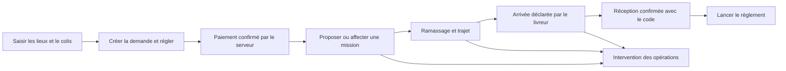
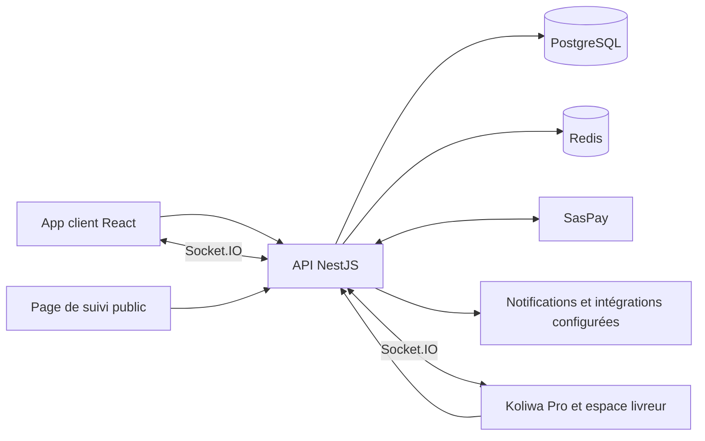

# Koliwa — Référentiel du projet

**Produit, opérations, design et technique**  
État documenté le **21 novembre 2026** à partir du dépôt local après annulation de la dernière refonte graphique.

Koliwa permet à un particulier ou à un commerce de faire transporter un colis à Ouagadougou, de régler la livraison sur la plateforme et d’en partager le suivi. La plateforme travaille avec des livreurs indépendants et des sociétés de livraison. **Koliwa** est la marque affichée. Le nom **Koliwa** figure encore dans les noms des dossiers, certains identifiants techniques et des adresses de service.

| Mention | Sens dans ce document |
| --- | --- |
| **En place** | Un écran, une règle ou une intégration figure dans le code local examiné. |
| **À vérifier** | Le code ou la configuration existe, et il reste à vérifier le parcours complet dans l’environnement visé. |
| **À construire** | Besoin produit identifié pour lequel il reste du travail. |
| **Plus tard** | Fonction envisageable après validation du service de livraison. |

Le document décrit un état du code et une direction produit. Il sert de référence pour discuter, concevoir, développer, tester et lancer le pilote.

## Sommaire

1. [Vision et modèle de départ](#1-vision-et-modèle-de-départ)
2. [Acteurs, responsabilités et interfaces](#2-acteurs-responsabilités-et-interfaces)
3. [Parcours de livraison](#3-parcours-de-livraison)
4. [Attribution, zones et application livreur](#4-attribution-zones-et-application-livreur)
5. [Suivi, réception et assistance](#5-suivi-réception-et-assistance)
6. [Paiements et finances](#6-paiements-et-finances)
7. [Comptes, candidatures et messages](#7-comptes-candidatures-et-messages)
8. [Identité visuelle et design](#8-identité-visuelle-et-design)
9. [Architecture, données et API](#9-architecture-données-et-api)
10. [Développement, tests et mise en production](#10-développement-tests-et-mise-en-production)
11. [Pilote, risques et feuille de route](#11-pilote-risques-et-feuille-de-route)

## 1. Vision et modèle de départ

### Le service

- **Envoyer un colis.** L’émetteur indique où récupérer le colis et à qui le remettre.
- **Faire récupérer une commande déjà passée.** Le client demande à Koliwa de retirer un achat chez un commerçant. Un repas déjà commandé peut être décrit comme contenu du colis. Le commerce conserve la vente et la préparation de cet achat.
- **Suivre une livraison.** L’émetteur suit le trajet depuis son compte. Le destinataire ouvre un lien partagé et peut confirmer la réception avec le code prévu à cet effet.

La livraison urbaine est la priorité. Le module VTC possède une route distincte et relève d’un autre parcours. La marketplace avec catalogue, panier, paiement des articles et gestion des vendeurs est une évolution possible. Elle dépendra de la capacité de Koliwa à livrer de façon fiable et à faire revenir ses clients.

### Pourquoi commencer par la livraison

Le projet est porté par une petite équipe. La livraison répond à une pratique déjà familière à Ouagadougou et permet de tester un problème précis. Les clients et commerces doivent pouvoir trouver un livreur disponible, connaître le prix et savoir si le colis est arrivé. La disponibilité des livreurs par quartier et par créneau, la volonté de payer et le nombre de clients qui reviennent sont à mesurer sur le terrain.

### Modèle recommandé pour le pilote

1. **Réseau de partenaires.** Recruter quelques livreurs indépendants et sociétés de livraison qui apportent leurs véhicules, leur matériel et leur disponibilité. Koliwa fournit la demande, le logiciel, le suivi et l’assistance.
2. **Périmètre court.** Commencer à Ouagadougou, dans quelques zones et créneaux où l’équipe peut assurer l’affectation, répondre aux incidents et trouver un livreur de secours.
3. **Paiement centralisé.** Afficher le coût de la livraison avant encaissement, traiter le paiement dans le parcours Koliwa et réconcilier les reversements au livreur ou à la société.
4. **Acquisition ciblée.** Partir de commerces qui font déjà livrer. Mesurer le volume et la réutilisation avant d’élargir les campagnes.
5. **Valeur qui donne envie de revenir.** Simplifier les adresses récurrentes, offrir un historique et un suivi partageable, traiter les incidents et tester les réductions sur les commandes qui ont une marge suffisante.

## 2. Acteurs, responsabilités et interfaces

| Acteur | Responsabilité | Interface |
| --- | --- | --- |
| Émetteur particulier ou commerce | Décrit le colis et les adresses, paie le transport, partage le suivi et peut signaler un incident. | App client |
| Destinataire | Suit la course et utilise le code de réception au moment de la remise. | Lien public de suivi, sans création de compte |
| Livreur indépendant ou rattaché à une agence | Déclare sa disponibilité, répond aux missions, se rend aux points indiqués et documente la remise. | Espace livreur Koliwa Pro |
| Société de livraison | Présente son entreprise, coordonne sa flotte et suit ses missions et règlements. | Espace agence Koliwa Pro |
| Commerce partenaire | Confie des livraisons à Koliwa ou prépare un colis à retirer. | App client ou espace professionnel selon le compte |
| Opérations | Surveille les demandes et les zones couvertes, intervient sur une affectation et gère les incidents de course. | Koliwa Pro |
| Support | Vérifie les dossiers et les preuves, répond aux clients et instruit les litiges dans le périmètre de son rôle. | Koliwa Pro |
| Finance | Réconcilie les paiements, les remboursements et les reversements par bénéficiaire. | Fonctions financières du Pro, avec permissions applicables |
| Direction et produit | Suit coût, fiabilité et réutilisation pour décider d’une extension de zone ou d’une amélioration. | Indicateurs opérationnels et données du pilote |
| Marketing | Prépare les messages, cible les groupes, programme les campagnes et mesure les résultats. | Modules de campagnes et de promotions |
| Équipe technique | Maintient le code, les intégrations, les environnements et le suivi des erreurs. | Dépôt, CI et outils d’exploitation |

Les rôles enregistrés côté API sont `client`, `courier`, `driver`, `business_admin`, `agency`, `support`, `admin` et `super_admin`. Les responsabilités « finance », « direction », « produit », « marketing » et « technique » sont des fonctions d’équipe. Définir leurs droits précis avant d’ouvrir un accès dédié. L’API contrôle l’accès aux opérations sensibles, avec vérification du rôle et, selon l’action, du lien avec la livraison ou l’organisation. [Rôles du backend](../fasofree-backend/src/modules/users/entities/user-role.enum.ts)

### Écrans client

| Parcours | Route | Usage |
| --- | --- | --- |
| Accueil | `/` | Ouvrir les services, saisir une référence, accéder au compte et aux notifications. |
| Connexion et récupération | `/auth` | Téléphone ou e-mail avec mot de passe. Récupération par e-mail et réinitialisation sur la même page. |
| Inscription et vérification | `/register`, `/verify-account` | Créer un compte client ou entamer une candidature professionnelle, puis vérifier le compte selon le parcours. |
| Envoyer | `/p2p-delivery` | Saisir ramassage, destination et détails du colis. |
| Faire récupérer | `/p2p-delivery?mode=merchant-pickup` | Saisir le commerce, le contact sur place et son repère de récupération. |
| Retour de paiement et reprise | `/p2p/success`, `/payment-error` | Revenir du paiement, retrouver la référence et le lien de suivi si disponibles, ou traiter un échec. |
| Suivi connecté | `/order-tracking?orderId=…` | Ouvrir sa livraison. Le compte peut être demandé après la saisie d’une référence. |
| Suivi partagé | `/track/:token` | Consulter le trajet sans compte et confirmer la réception lorsque la course attend le code. |
| Historique et compte | `/order-history`, `/profile`, `/addresses`, `/settings` | Retrouver ses livraisons, gérer profil, adresses et préférences. |
| Réclamations et pass | `/disputes`, `/vip-pass` | Traiter les réclamations et accéder à l’offre d’abonnement existante. |
| Aide et documents | Pied de page, assistant, `/terms`, `/privacy`, `/cookies`, `/cgv`, `/remboursement`, `/legal/:docCode` | Contacter le support et consulter les textes servis par l’API. |
| Mobilité | `/ride` | Parcours VTC protégé, séparé du parcours de livraison. |

### Écrans professionnels

| Route Pro | Usage |
| --- | --- |
| `/login`, `/register`, `/contrat` | Accès, entrée en candidature et signature lorsque le rôle le permet. |
| `/livreur` | Disponibilité, missions, navigation, progression et revenus du livreur. |
| `/agences` | Supervision de la société de livraison et de son activité. |
| `/designer` | Espace professionnel hérité pour les comptes marchands et établissements. |
| `/dashboard/live-orders` | Pilotage des courses en direct. |
| `/dashboard/applications` | Traitement des candidatures. |
| `/admin/support`, `/admin/manager`, `/admin/super` | Vues support, gestion et administration, avec droits différenciés. |

L’espace livreur et les tableaux d’équipe partagent aujourd’hui une PWA Pro et des routes protégées. L’architecture produit prévoit trois interfaces distinctes pour le client, le livreur et les opérations. Une application livreur autonome reste une étape ultérieure si les tests terrain et le besoin de localisation la justifient. [Routes client](../fasofree-frontend-client/src/App.jsx) · [Routes Pro](../fasofree-frontend/src/App.jsx)

## 3. Parcours de livraison

### Remplir la demande

1. **Ramassage.** Adresse ou nom du commerce, quartier, nom et téléphone du contact. Le mode récupération exige un repère utile au livreur, par exemple une entrée ou un point connu à proximité.
2. **Livraison.** Adresse d’arrivée, nom et téléphone du destinataire, consigne d’accès si nécessaire.
3. **Colis.** Description et valeur déclarée. Le poids, la fragilité et les dimensions précisent les conditions du transport.
4. **Récapitulatif.** Afficher l’estimation, les frais applicables, les deux lieux et le contenu avant confirmation. Le serveur détermine le montant final.
5. **Confirmation.** Une session est requise pour soumettre. Le brouillon est préparé dans le stockage de session pour reprendre après connexion. Tester la reprise dans les deux modes, en particulier la récupération chez un commerce, car la redirection vers l’authentification mémorise actuellement `/p2p-delivery` sans son paramètre `mode`.

Aujourd’hui, la validation accepte une adresse textuelle et le GPS est facultatif. Le formulaire initialise les deux positions aux coordonnées du centre de Ouagadougou et peut transmettre ces valeurs si aucun GPS précis n’a été fourni. Tant que le point exact est inconnu, traiter l’estimation et l’affectation par proximité comme **approximatives**. La suite prévue est de rendre ce niveau de précision explicite, puis de proposer une recherche d’adresse, un point sur la carte et l’enregistrement de lieux récurrents. Le bouton « Utiliser ma position » correspond à la position de l’appareil de la personne qui remplit le formulaire. Il convient au commerce quand cette personne se trouve sur place.

Le payload actuel utilise `P2P_DELIVERY` pour l’envoi et la récupération. L’interface de création P2P comporte trois étapes et les champs décrits ci-dessus. Choix d’un créneau, délai annoncé par zone, référence du commerce et validation d’un tarif ferme avant le checkout sont des points à traiter séparément. Un état `SCHEDULED` existe côté backend. Sa présence ne suffit pas à proposer la programmation dans ce formulaire. [Création P2P côté client](../fasofree-frontend-client/src/pages/P2PDelivery/index.jsx) · [Valeurs initiales](../fasofree-frontend-client/src/pages/P2PDelivery/constants.js)

### Lire les statuts

| Ce que voit le client | État serveur observé ou compatible avec l’existant |
| --- | --- |
| À payer / paiement en cours | `PENDING` ou `AWAITING_PAYMENT`, selon l’étape et le parcours |
| Payé, recherche de livreur | `PAID` et informations de dispatch |
| Livreur attribué | `DRIVER_ASSIGNED` ou `PROCESSING`, selon la voie d’affectation |
| Colis en route | `IN_DELIVERY` |
| Livreur arrivé, réception à confirmer | `DELIVERED_PENDING_CONFIRMATION` |
| Remis | La validation par code amène à `COMPLETED`. L’interface gère aussi `DELIVERED` pour les parcours existants. |
| Incident | `CANCELLED`, `FAILED`, `DISPUTED` ou `REFUNDED` selon le cas |

`IN_PREPARATION` et `READY_FOR_PICKUP` restent dans le modèle partagé avec les parcours historiques. Les noms `OPEN_FOR_ACCEPTANCE`, `CLAIMED` ou `DELIVERED_CONFIRMED` rencontrés dans la proposition d’architecture décrivent des étapes métier. Les noms exacts stockés figurent dans l’énumération de l’entité. [États et types serveur](../fasofree-backend/src/modules/orders/entities/order.entity.ts) · [Règles de transition](../fasofree-backend/src/modules/orders/orders.service.ts)



## 4. Attribution, zones et application livreur

### Disponibilité et prise de course

**En place.** Le backend possède le dispatch automatique, la liste des missions disponibles, l’acceptation, le refus, l’affectation manuelle et des mécanismes de reprise et d’escalade. L’espace livreur reçoit et affiche les informations des missions selon sa session. Les différents modes d’envoi aux livreurs ou agences doivent être testés ensemble dans l’environnement du pilote.

Une prise de mission via `POST /dispatch/accept/:orderId` verrouille la commande et la ligne du livreur dans une transaction. Le serveur vérifie l’état de la commande, l’attribution éventuelle, la capacité et la zone. Le premier livreur à obtenir une confirmation du serveur prend la mission. Les mises à jour temps réel partent après l’enregistrement. Pour le pilote, vérifier que le bouton utilisé par le livreur et les autres voies d’affectation appliquent les mêmes garanties, notamment en cas de demandes simultanées.

**Cumul en place.** Le maximum est de **trois livraisons actives**. La règle actuelle compare les points de ramassage entre eux et les destinations entre elles, à **2 km maximum** pour chaque course active lorsque les coordonnées sont présentes. Une position manquante ne bloque pas cette comparaison. Les coordonnées approximatives du centre de Ouagadougou peuvent rendre la comparaison peu représentative. Les états comptés sont `DRIVER_ASSIGNED`, `PROCESSING`, `IN_DELIVERY` et `DELIVERED_PENDING_CONFIRMATION`. Tester également la remise en disponibilité après la fin de la troisième mission.

**À préciser pour le pilote.** Définir la zone éligible, la fraîcheur maximale de la position et le délai de chaque vague. Une première recherche proche puis un élargissement progressif sont la direction retenue. La distance de cumul de 2 km est une règle existante. Le rayon initial de diffusion et sa modification depuis le tableau de bord restent des décisions à configurer et à vérifier. Les opérations doivent disposer d’une solution lorsque personne n’accepte, lorsque le colis est indisponible ou lorsque le destinataire est absent. [Règles de cumul](../fasofree-backend/src/modules/dispatch/delivery-rules.ts) · [Acceptation et refus](../fasofree-backend/src/modules/dispatch/dispatch.controller.ts) · [Dispatch et escalade](../fasofree-backend/src/modules/dispatch/dispatch.service.ts)

### Interface et connexion mobile du livreur

| Moment | L’écran doit rendre clair |
| --- | --- |
| Mise en service | Statut du dossier, véhicule, disponibilité en ligne ou hors ligne et dernière position connue. |
| Offre de mission | Secteurs de ramassage et d’arrivée, type de colis, distance et rémunération lorsque disponibles, choix accepter ou refuser. |
| Prise confirmée | Résultat serveur, autres missions actives, prochain arrêt et action de navigation. |
| Ramassage et trajet | Repère, coordonnées disponibles, progression, appel ou assistance autorisés et conduite à tenir en cas d’imprévu. |
| Remise | Arrivée déclarée par le livreur, état en attente du code, confirmation par la personne autorisée. |
| Après la course | Historique, montant dû, versement et écart éventuel entre les deux. |

L’espace livreur ouvre déjà des itinéraires ou des recherches dans Google Maps. Le pilote doit mesurer le comportement réel lorsque le livreur bascule sur Maps, verrouille son téléphone ou passe dans une zone à faible débit. La carte intégrée sert à situer les points et à lire le suivi. Les consignes et étapes doivent rester accessibles sous forme de texte.

Pour limiter la consommation, envoyer la position uniquement pendant la disponibilité ou une mission, adapter la fréquence au déplacement et afficher l’heure de la dernière position. Conserver un état lisible en cas de coupure, reprendre sans doublon et compresser les images de preuve. En cas de suivi en arrière-plan insuffisant pendant le pilote, instruire une application livreur dédiée avec permissions et service de localisation adaptés au téléphone. [Espace livreur](../fasofree-frontend/src/dashboard/DriverDashboard.jsx)

## 5. Suivi, réception et assistance

### Deux accès, une livraison

- **Émetteur connecté.** Il retrouve sa livraison par référence ou depuis l’historique. Le suivi comporte les adresses et étapes utiles, ainsi que la carte et le contact d’assistance lorsque disponibles.
- **Destinataire.** La page `/track/:token` présente un lien signé et expirant. La durée de signature par défaut dans le service est de **30 jours**. La page actualise ses données toutes les **12 secondes** quand elle est active, et affiche une carte lorsque des points sont disponibles. Le retour de paiement peut proposer de copier le lien. La réception automatique par SMS ou WhatsApp n’a pas été établie pour ce parcours.
- **Remise.** Le livreur déclare l’arrivée. Le serveur accepte ensuite la confirmation par PIN dans l’état `DELIVERED_PENDING_CONFIRMATION`. Une confirmation publique est limitée à cinq requêtes par minute dans la configuration de l’endpoint. La validation correcte horodate la réception, passe à `COMPLETED` et déclenche le traitement du règlement. L’API possède également une validation client connectée et des voies de traitement administratif.

**Écart à fermer avant le pilote.** L’objectif produit est que le destinataire contrôle la confirmation en usage normal. Le code actuel permet aussi de confirmer depuis le compte de l’émetteur et l’arrivée peut transmettre le code dans un événement de la livraison. Une tâche horaire peut passer à `COMPLETED` une course en attente depuis plus de 24 heures après validation par le livreur. Cette tâche déclenche le traitement du règlement et peut donc présenter une course comme remise sans saisie de PIN par le destinataire. Il faut vérifier les destinataires de cet événement, isoler l’envoi du PIN pour le receveur et définir un recours support tracé pour les exceptions. Vérifier aussi la possibilité de révoquer un lien, les champs que reçoit l’accès public et la proportion d’adresses ou de téléphones réellement nécessaire pour chaque rôle. [Contrôleur du suivi public](../fasofree-backend/src/modules/orders/public-tracking.controller.ts) · [Suivi, jeton et validation](../fasofree-backend/src/modules/orders/orders.service.ts) · [Page de suivi partagée](../fasofree-frontend-client/src/pages/PublicTracking.jsx) · [Partage du lien](../fasofree-frontend-client/src/pages/P2PDelivery/SuccessScreen.jsx)

### Quand une course dévie du parcours prévu

| Situation | Traitement proposé au pilote |
| --- | --- |
| Impossible de joindre le contact, colis absent ou adresse imprécise | Vérifier le repère, tracer l’appel ou le message autorisé et demander au support de décider du retour, du report ou de l’annulation. |
| Aucun livreur disponible | Afficher l’état d’attente, activer une société de secours ou expliquer le délai et les choix possibles. |
| Destinataire absent ou code introuvable | Garder la course en attente, enregistrer motif, heure et action suivante. La résolution manuelle suit une procédure et laisse une trace. |
| Colis endommagé ou non reçu | Ouvrir une réclamation liée à la référence. Rassembler les étapes, messages et preuves autorisées avant décision. |
| Débit faible ou carte indisponible | Afficher les adresses, le statut et l’heure de la dernière donnée disponible. Permettre de reprendre au retour de la connexion. |

Le PIN est la preuve de base du parcours actif. Une photo ou une signature doit répondre à un besoin précis, avec des règles d’accès, de conservation et de consentement définies avant activation. La prévention des contournements passe par une raison de rester sur Koliwa, un partage limité des coordonnées, un contact lié à la mission et des procédures accessibles en cas de problème. Le relais d’appel ou le masquage de numéro reste à instruire.

## 6. Paiements et finances

### Estimation et montant

Le calcul local de référence utilise la distance à vol d’oiseau. Les valeurs ci-dessous décrivent l’estimation dans le code et servent à comprendre le parcours. Le tarif payé est calculé côté serveur avec les règles financières applicables.

| Élément | Valeur dans le calcul client |
| --- | --- |
| Base de livraison | 1 000 FCFA |
| Distance | 200 FCFA par kilomètre |
| Fragilité | 100 FCFA si l’option est cochée |
| Poids | 50 FCFA par kilogramme au-dessus de 5 kg |
| Arrondi | Multiple de 50 FCFA supérieur |
| Frais de service | L’interface annonce 100 FCFA séparément de cette estimation. |

Exemple indicatif pour 3 km et un colis de 6 kg fragile. Le transport estimé vaut 1 750 FCFA, soit 1 850 FCFA avec les 100 FCFA affichés de frais de service, sous réserve du recalcul serveur et des règles du compte. [Calcul client](../fasofree-frontend-client/src/utils/p2pPricing.js) · [Création et calcul financier serveur](../fasofree-backend/src/modules/orders/orders.service.ts)

### Chaîne de paiement

1. Le serveur crée la demande et calcule le détail financier. Le compte de l’émetteur doit avoir un téléphone valide.
2. Le prestataire intégré dans `payments` est **SasPay**. Le client peut être redirigé vers le checkout rendu par le serveur.
3. Le retour navigateur sert à reprendre le parcours. L’état encaissé doit venir de la vérification serveur du paiement. Le webhook SasPay vérifie la signature, puis rapproche et traite l’événement.
4. Les mouvements sont rattachés à la livraison et à la transaction. Les portefeuilles, recharges, retraits, annulations, remboursements et règlements disposent de parcours serveur à vérifier selon les rôles et l’environnement.
5. L’équipe finance compare le montant facturé, les frais, le règlement dû, le règlement exécuté et l’éventuel remboursement. Le support doit pouvoir transmettre une référence exploitable sans manipuler d’identifiants de paiement confidentiels.

Vérifier en préproduction les moyens d’encaissement et de reversement disponibles, la reprise en cas de webhook dupliqué, le remboursement et la réconciliation. Le paiement à la livraison est une option de politique produit à traiter séparément. Chaque exception change le risque d’annulation et le travail de réconciliation. [Module de paiement](../fasofree-backend/src/modules/payments/payments.module.ts) · [Statut, réconciliation et webhook](../fasofree-backend/src/modules/payments/payments.controller.ts)

### Économie d’une course

Tenir un tableau par zone et type de course avec le montant payé, la rémunération du transport, les frais du prestataire, la remise utilisée, le coût du support et les remboursements. La marge de contribution s’obtient en soustrayant les coûts variables réellement supportés des sommes conservées pour le service. Le volume de livraisons, la somme des paiements et la marge sont trois mesures distinctes. Les coursiers indépendants et les sociétés peuvent nécessiter des modalités de règlement différentes.

## 7. Comptes, candidatures et messages

| Domaine | En place dans le dépôt | À vérifier ou construire |
| --- | --- | --- |
| Compte client | Inscription, connexion par téléphone ou e-mail et mot de passe, vérification du compte, oubli et réinitialisation par e-mail. | Confirmer les canaux disponibles selon l’environnement. Décider si une connexion principale par SMS OTP est souhaitée. |
| Candidature livreur | Formulaire, pièces KYC, accès au suivi et à la décision côté Pro. | Valider la liste exacte des justificatifs par type de véhicule, les droits d’accès et les délais de traitement. |
| Candidature société | Parcours d’agence et gestion côté Pro, onboarding et documents. | Vérifier le dossier KYB de bout en bout avec les pièces, le représentant, le contrat, la flotte et le compte de règlement. |
| Décision sur dossier | Actions d’approbation ou refus et notifications transactionnelles prévues. | Vérifier réception et délai de l’e-mail. Tester un éventuel canal WhatsApp séparément avant de l’annoncer. |
| Notifications d’app | Boîte in-app et mécanisme d’inscription FCM. | Le push client est conditionné à `VITE_PUSH_ENABLED=true` et à la configuration Firebase. Vérifier autorisations, appareils et repli dans la boîte in-app. |
| Campagnes | Backend de campagnes, routes d’administration et fonctionnalités de planification ou récurrence selon le parcours. | Tester l’envoi manuel, l’heure planifiée en affichage Ouagadougou, l’annulation, le ciblage et le résultat avec un petit groupe de test. |
| Fidélisation | Page pass et modules d’abonnement, promotions, fidélité et affiliation. | Construire les règles Koliwa de remises, crédits, pass, parrainage et bonus livreurs, puis mesurer leur rentabilité. |
| Jeux et récompenses | Idées de fidélisation. | À envisager après stabilisation du service. Définir l’éligibilité, le budget, la fréquence et les règles de traitement des abus. |

Les messages d’état et de campagne utilisent la boîte in-app comme base opérationnelle. Les e-mails transactionnels couvrent des actions liées au compte et aux décisions selon la configuration. Des intégrations et options SMS ou WhatsApp existent dans le dépôt. Le canal effectivement utilisé doit être établi pour chaque événement dans l’environnement du pilote.

Pour le livreur, le dossier doit couvrir identité, téléphone, moyens de transport et de règlement, ainsi que les justificatifs retenus avec l’équipe. Pour une société, ajouter raison sociale, documents d’entreprise, représentant habilité, coordonnées, flotte et modalités de collaboration. Le minimum utile varie avec la situation. Les documents et décisions restent accessibles aux personnes autorisées, avec trace de la décision.

Sources de travail. [Authentification](../fasofree-backend/src/modules/auth/auth.controller.ts) · [Candidatures](../fasofree-backend/src/modules/onboarding/onboarding.controller.ts) · [KYC](../fasofree-backend/src/modules/kyc/kyc.controller.ts) · [Campagnes](../fasofree-backend/src/modules/push-campaigns/push-campaign.controller.ts) · [Promotions](../fasofree-backend/src/modules/promotions/promotions.controller.ts)

## 8. Identité visuelle et design

### Signe, marque et visuels

**Nom.** Écrire **Koliwa** pour le service client et **Koliwa Pro** pour l’espace professionnel. Garder un ton simple, rassurant et concret. La marque se lit dans l’interface, les écrans de lancement, les icônes installées et le suivi.

**Signe.** Le K tissé retenu assemble des traits qui se croisent. Ses tons or et crème s’appuient sur le fond cacao des icônes. Le mot Koliwa accompagne le signe dans les en-têtes qui disposent de place. La petite icône doit rester reconnaissable dans les raccourcis, la navigation et les favicons. Réserver le losange doré et le libellé **Remis** à l’état final présenté par le suivi. Conserver le mot à côté du symbole pour que l’information reste lisible à elle seule.

**Ancrage local.** La photographie du Monument des Héros situe le service à Ouagadougou. Sur l’authentification, laisser voir la silhouette du monument et ses éléments reconnaissables. Le textile est une vraie photographie de **Faso Dan Fani burkinabè**. Il apparaît en bande indigo sur la connexion et de manière plus discrète sur l’accueil, l’inscription et le pied de page. Employer la texture sur les zones de marque et laisser les champs, preuves et actions sur des surfaces lisibles. Les visuels de livraison propres à Koliwa peuvent compléter le monument et le textile. [Planche du K tissé](koliwa-k-tisse-remise.png) · [Fichier source du signe](../tools/koliwa-mark.svg) · [Photographie Faso Dan Fani et crédit CC0](https://commons.wikimedia.org/wiki/File:Textile_Faso_Dan_Fani_(Burkina_Faso).jpg)

### Palette actuelle

| Usage | Valeurs de référence dans le code |
| --- | --- |
| Fond de page clair et surface de carte | Crème `#F7EBDD` et ivoire `#FFF9F0`. |
| Surfaces secondaires | Beige `#E8D3B6` et sable `#D4B28C`. |
| Texte principal et déclinaisons | Chocolat `#4C2E24`, café `#7B5C4C`. |
| Accent | Terracotta doux `#B86F55`, accent clair `#D4A27E`, accent foncé `#8A533E`. |
| Signe et remise | Cacao `#41241C`, crème `#FFF1DD`, or `#D5A453`. |
| Connexion | Fond `#F8EFE3`, texte `#3F291F`, bordure `#CFBCA8`, accent `#79452F`. |
| États de l’app | Vert olive `#5C6B3C`, ambre `#B8862E`, rouge `#B5502E`, bleu-gris `#5C6B7A`. |

Le thème clair est le choix initial. L’app mémorise une préférence sombre choisie par l’utilisateur. La connexion applique une composition claire dédiée. Le contraste doit être vérifié sur les surfaces réelles, notamment pour les textes d’aide, les statuts, les boutons désactivés et le mode sombre. [Palette Tailwind](../fasofree-frontend-client/tailwind.config.js) · [Feuille de styles client](../fasofree-frontend-client/src/index.css) · [Préférence de thème](../fasofree-frontend-client/src/contexts/DarkModeContext.jsx)

### Typographie et composants

- **Bricolage Grotesque** donne du caractère aux titres d’app et aux titres de service. Soigner le retour à la ligne des titres longs sur petit écran.
- **Manrope** sert au texte courant, aux champs et aux détails opérationnels. Les alternatives système évitent un blocage de rendu si la police distante tarde.
- **Playfair Display** porte le mot-symbole, le grand titre de connexion et certains titres éditoriaux du pied de page et de l’inscription.
- **IBM Plex Mono** marque les petits libellés et références lorsque la lecture du format en bénéficie. Les consignes de formulaire et le contenu d’aide privilégient la lisibilité du texte courant.
- **Lucide** est la famille d’icônes actuelle. Associer un nom accessible aux commandes qui n’affichent qu’une icône. Éviter les emojis et autocollants dans l’interface.
- **Composants partagés.** Les classes `app-page`, `app-header`, `app-panel`, `app-input`, `app-action` et `app-action-secondary` donnent le point de départ pour harmoniser les pages. Les modules clients possèdent aussi des variantes locales. Regrouper les variantes au fil des retouches qui les concernent.
- **Mouvement.** Réserver les transitions courtes aux ouvertures, changements d’écran et retours d’action. Éviter animations de respiration, mouvement décoratif répétitif et rebonds sur les formulaires. Vérifier le réglage de réduction des animations.
- **Accessibilité.** Tester navigation clavier, focus visible, libellés des champs, zones tactiles, zoom, contraste et lecteurs d’écran. Une erreur indique le champ ou la prochaine action. Un statut important se lit dans le texte et le symbole. Une action en cours affiche sa progression.

### Application du design, écran par écran

| Écran | Composition et contrôles |
| --- | --- |
| Accueil | Le logo et le contexte « Livraison à Ouagadougou » ouvrent la page. Les trois services sont visibles avant le bloc illustré. Conserver le suivi par référence et garder les accès immédiats sur téléphone. |
| Connexion | Sur ordinateur, monument et bande textile d’un côté, formulaire de l’autre. Sur mobile, photo compacte puis formulaire. Donner un accès visible à la récupération de mot de passe et à l’inscription. |
| Inscription | Présenter les profils client, partenaire, livreur et société. Les choix doivent tenir dans l’espace utile. Le monument et le textile portent l’ambiance, le formulaire garde des champs lisibles et des erreurs proches de la saisie. |
| Envoi et récupération | Une étape à la fois. Séparer adresse, contact et instructions. Laisser la saisie avancer sans coordonnées manuelles. Montrer le tarif, les deux lieux et l’action suivante sans confusion. |
| Suivi | Afficher statut et prochaine action, carte si disponible, lieux et historique. Principe commun au client et au destinataire, avec des droits et données adaptés. Réserver « Remis » à la fin. Prévoir loading, lien expiré, aucun GPS, incident et réception confirmée. |
| Navigation et pied de page | La barre basse mobile persiste dans le périmètre du layout client. Elle sert à Accueil, Nouvelle, Mes livraisons et Profil. Authentification et suivi public ont leurs propres en-têtes. Le pied de page regroupe services, contact et textes utiles. |
| Livreur | Écran lisible d’un coup d’œil pendant un arrêt. Distinguer les missions proposées et attribuées. Donner accès à la navigation et faire ressortir le prochain geste. |
| Pro et opérations | Tableaux et cartes pour filtrer, trouver une course, distinguer statuts et délais et agir avec le droit attaché au rôle. Donner la priorité à l’information opérationnelle et aux traces. |

L’amélioration se fera par petits lots. Pour chaque écran, partir du problème observé, garder les libellés utiles, modifier une zone lisible et vérifier le parcours sur téléphone et ordinateur avant de généraliser. Le style sombre et vert de la dernière exploration a été annulé. Les retouches suivantes partent de la version crème, café et chocolat décrite ici.

## 9. Architecture, données et API

### Carte du dépôt

| Dossier | Contenu |
| --- | --- |
| [`fasofree-frontend-client`](../fasofree-frontend-client/) | App client React et Vite, routage React Router, composants Tailwind, état Zustand, requêtes TanStack Query, Leaflet, notifications et Socket.IO. PWA installable. |
| [`fasofree-frontend`](../fasofree-frontend/) | Koliwa Pro en React, Vite et Tailwind, tableaux par rôle, espace livreur, cartes, appels API et Socket.IO. PWA installable. |
| [`fasofree-backend`](../fasofree-backend/) | API NestJS et TypeScript, entités TypeORM, PostgreSQL, Redis, tâches planifiées, événements et temps réel Socket.IO. Swagger et tests Jest. |
| [`fasofree-agent`](../fasofree-agent/) | Lanceur interne Koliwa, serveur Express séparé. Le client possède par ailleurs son propre assistant intégré à l’expérience client. |
| [`tools`](../tools/) | Scripts et sources d’outillage, dont la génération des variantes d’icônes Koliwa. |
| [`deploy`](../deploy/) et [`.github/workflows`](../.github/workflows/) | Configurations de déploiement et d’intégration continue. |
| [`docs`](./) | Audits, plans de phases, visuels de marque et documents d’exploitation. |



### Domaines du backend

| Domaine | Modules principaux |
| --- | --- |
| Identité, accès, confidentialité | `auth`, `users`, `otp`, `kyc`, `onboarding`, `legal`. |
| Livraison et opérateurs | `orders`, `dispatch`, `tracking`, `addresses`, `agencies`, `businesses`, `brands`. |
| Paiements et contrôle | `payments`, `wallets`, `financial`, `receipts`, `disputes`, `fraud`, `penalties`, `audit`. |
| Communication et contenus | `notifications`, `push-campaigns`, `chat`, `internal-chat`, `assistant`, `upload`, `stories`, `reviews`. |
| Croissance et configuration | `analytics`, `affiliate`, `loyalty`, `promotions`, `subscriptions`, `settings`, `health`, `seed`. |
| Compatibilité marchande | `products` et fonctions marchandes encore présentes. Leur présence sert à comprendre les contrats techniques et l’historique du dépôt. La marketplace relève d’un chantier produit distinct. |

Les données principales sont le compte et son rôle, les adresses, les candidatures et justificatifs, l’agence ou le commerce, la livraison et ses positions, l’affectation, la transaction, les mouvements financiers, les notifications, les réclamations et la trace d’activité. Les colonnes et contraintes effectives se lisent dans les entités et les migrations. Les noms ou états de la feuille de route ne deviennent des champs qu’après décision et migration si nécessaire.

### Repères API

Le préfixe courant est `/api/v1`. Swagger est configuré dans `src/main.ts` sur `/api/docs` quand il est activé. Les méthodes et routes ci-dessous orientent la lecture du code.

| Fonction | Routes représentatives |
| --- | --- |
| Session et compte | `POST /auth/register`, `POST /auth/login`, `GET /auth/me`, `POST /auth/forgot-password`, `POST /auth/reset-password`. |
| Livraison | `POST /orders`, `POST /orders/quote`, `GET /orders/my-orders`, `GET /orders/:id/tracking`. |
| Missions | `GET /dispatch/available`, `POST /dispatch/accept/:orderId`, `POST /dispatch/refuse/:orderId`, `POST /orders/:id/assign`. |
| Position et preuve | `POST /orders/:id/driver-location`, `POST /orders/:id/driver-validate`, `POST /orders/:id/client-validate`. |
| Suivi partagé | `GET /public-tracking/:token`, `POST /public-tracking/:token/confirm`. |
| Paiement | `GET /payments/status/:orderId`, `GET /payments/admin/reconcile/:orderId`, `POST /payments/webhook/saspay`. |
| Candidatures et KYC | `POST /auth/apply`, `GET /users/applications`, `POST /users/applications/:id/approve`, `POST /users/applications/:id/reject`, `GET /kyc/admin/pending`. |
| Campagnes | `POST /admin/push-campaigns`, `GET /admin/push-campaigns`, `PATCH /admin/push-campaigns/:id/stop`. |
| Exploitation | `GET /health`, mise en service Render sur `/api/v1/health/ready`. |

### Sécurité, données privées et cache

- **Session et droits.** JWT et contrôles d’accès au backend. Tester droits et périmètre de chaque API, fichier, conversation et salon temps réel. Une page cachée en front ne constitue qu’une règle d’interface.
- **Données personnelles.** Partager avec chaque rôle les champs nécessaires à sa mission. Contrôler la durée et les accès aux adresses, positions, pièces KYC, photos et numéros. Masquer les secrets, jetons, PIN et données sensibles dans les traces.
- **Paiements.** Vérifier le webhook, rapprocher la transaction, gérer le rejeu sans double mouvement et garder une trace de chaque régularisation.
- **Migrations.** La synchronisation automatique des entités est réservée au développement. Les évolutions du schéma en production passent par les migrations TypeORM et une vérification des données existantes.
- **PWA.** Les deux apps construisent un manifeste et un service worker. Le cache de navigation sert l’entrée de l’application, avec exceptions pour les appels API, Socket.IO et les tuiles. Tester accès direct, rechargement sur une route et retour après mise à jour. La PWA peut afficher des ressources déjà disponibles. Les opérations distantes dépendent encore du réseau.
- **Mesure.** Distinguer l’échec d’un appel, le délai d’attente, l’erreur de validation, le refus autorisé et l’incident réel. Suivre les événements de création, paiement, dispatch, réception et règlement avec une référence de course.

[Entrée serveur](../fasofree-backend/src/main.ts) · [Configuration client PWA](../fasofree-frontend-client/vite.config.js) · [Service worker client](../fasofree-frontend-client/src/sw.js) · [Migrations](../fasofree-backend/src/database/migrations/) · [Notes de sécurité du projet](SECURITY.md)

## 10. Développement, tests et mise en production

### Monter un environnement local

Utiliser Windows PowerShell dans le dossier `fasofree-main`. Les quatre composants ont chacun leur `package-lock.json`. Le Dockerfile backend utilise Node 24. La CI actuelle est configurée en Node 20, donc le résultat obtenu dans un environnement doit être recontrôlé dans l’autre lorsqu’une dépendance ou le runtime change. Docker peut fournir PostgreSQL avec PostGIS et Redis en local.

1. **Préparer l’API.** Dans `fasofree-backend`, consulter `.env.example` et placer les valeurs de développement dans un fichier local. Renseigner PostgreSQL et Redis, un secret JWT de développement et l’origine CORS des frontends. Activer les intégrations externes uniquement dans l’environnement où elles sont nécessaires.
2. **Démarrer les services locaux.** Ouvrir un terminal pour la base et le backend.

```powershell
Set-Location .\fasofree-backend
docker compose up -d postgres redis
npm.cmd ci
npm.cmd run start:dev
```

L’API écoute par défaut sur le port **3100**. Vérifier `http://127.0.0.1:3100/api/v1/health` avec les services démarrés.

3. **Démarrer le client.** Depuis la racine, ouvrir un deuxième terminal. Pour ce test, fixer explicitement l’URL de l’API locale, car le frontend possède une URL distante de repli.

```powershell
Set-Location .\fasofree-frontend-client
npm.cmd ci
$env:VITE_API_BASE_URL = 'http://127.0.0.1:3100/api/v1'
npm.cmd run dev -- --host 127.0.0.1 --port 3003 --strictPort
```

Ouvrir `http://127.0.0.1:3003/`. Le port Vite configuré dans le dépôt est 3000. La commande ci-dessus fixe un autre port pour distinguer les services locaux. Garder `127.0.0.1` dans l’URL et les origines CORS si c’est l’hôte choisi.

4. **Démarrer le Pro.** Depuis la racine, ouvrir un troisième terminal.

```powershell
Set-Location .\fasofree-frontend
npm.cmd ci
$env:VITE_API_URL = 'http://127.0.0.1:3100/api/v1'
npm.cmd run dev -- --host 127.0.0.1 --port 5173 --strictPort
```

Ouvrir `http://127.0.0.1:5173/login`. Pour le lanceur interne, `npm.cmd start` dans `fasofree-agent` démarre le serveur Express séparé. Régler son port et ses intégrations dans son environnement selon l’usage.

| Intégration | Configuration à repérer |
| --- | --- |
| Base, cache et session | `DATABASE_URL` ou configuration `DB_*`, `REDIS_URL` ou configuration Redis, `JWT_SECRET`, CORS et origines client. |
| API côté client et Pro | `VITE_API_BASE_URL` côté client, `VITE_API_URL` côté Pro. Les deux incluent le préfixe de l’API. |
| Encaissement et reversement | Configuration active dans `payments/providers/saspay.service.ts`. Variables `SASPAY_API_KEY`, `SASPAY_WEBHOOK_SECRET`, `SASPAY_COUNTRY`, `SASPAY_PAYOUT_NETWORKS` selon le cas. Le retour P2P utilise `P2P_SUCCESS_URL`. |
| Notifications et e-mails | Paramètres Firebase et `VITE_PUSH_ENABLED` selon l’app, configuration d’expédition transactionnelle, canaux complémentaires selon les parcours retenus. |
| Fichiers et supervision | Configurations de stockage et de suivi d’erreurs selon le déploiement. Les secrets se trouvent dans l’environnement du service. |

Les exemples d’environnement et certaines notes historiques citent encore GeniusPay. Pour déterminer la configuration active du paiement, partir de `PaymentsModule` et du prestataire importé. [Exemple d’environnement backend](../fasofree-backend/.env.example) · [Services Docker locaux](../fasofree-backend/docker-compose.yml) · [Client SasPay](../fasofree-backend/src/modules/payments/providers/saspay.service.ts)

### Vérifier une modification

Pour un changement visuel, contrôler l’accueil, l’envoi, la connexion ou le suivi concernés à une largeur mobile proche de 375 px, sur ordinateur, au clavier et avec des données longues. Vérifier le thème, les états vide, chargement, erreur et succès, ainsi que l’accessibilité du bouton principal avec la navigation fixe. Commencer par l’interface et les tests locaux. Un test de paiement, de notification ou de reversement appartient à un environnement dédié et à des comptes de test.

| Niveau | Contrôles |
| --- | --- |
| App client et Pro | Dans chaque dossier, `npm.cmd run build`. Vérifier le manifeste, le service worker généré, les routes profondes et le retour de paiement en préproduction. |
| Backend | Dans `fasofree-backend`, `npx.cmd tsc --noEmit`, `npm.cmd run build`, `npm.cmd test`. Pour le périmètre dédié, utiliser les tests e2e configurés dans le package backend. |
| Chaîne complète | Parcours avec deux identités, du brouillon jusqu’au code de réception et au règlement. Vérifier aussi refus, échec de paiement, récupération du brouillon, mauvaise position, PIN invalide et problème de réseau. |
| Concurrence et sécurité | Deux livreurs acceptent la même course, quatre offres visent le même livreur, webhook reçu plusieurs fois, réponse tardive du prestataire, token expiré, appel d’un rôle hors périmètre et reprise après redémarrage. |
| Continuité | Simuler une mise à jour de l’app installée, un rejet de notification, un checkout interrompu et un retour à l’application après une coupure. |

La vérification confirmée lors de l’annulation graphique est la compilation de l’app client et de son service worker. Les scénarios métier ci-dessus constituent le plan de recette du projet.

### Déployer et exploiter

- Versionner les modifications choisies après validation locale. Le workflow GitHub Actions à la racine construit les deux frontends et vérifie le backend.
- Déployer d’abord en préproduction avec une base et des comptes de test, les variables minimales et le retour de paiement propre à cet environnement.
- Le dépôt contient une configuration Render pour l’API Docker, des entrées frontend et un dossier de déploiement alternatif avec Caddy et une configuration de processus. Avant une publication, confirmer l’infrastructure réellement utilisée et les domaines de chaque service.
- Vérifier la disponibilité de l’API, appliquer les migrations prévues, tester la connexion, les routes profondes des PWA et le parcours d’une course.
- Garder une procédure pour suspendre la prise de commandes si le paiement, le dispatch ou le suivi devient indisponible. Revenir à un déploiement connu et vérifier les demandes, paiements et règlements déjà en cours. Les migrations de données nécessitent leur propre stratégie de reprise.

[Workflow CI](../.github/workflows/ci.yml) · [Dockerfile backend](../fasofree-backend/Dockerfile) · [Configuration Render](../render.yaml) · [Notes de production](PRODUCTION.md) · [Reprise après incident](DISASTER_RECOVERY.md)

## 11. Pilote, risques et feuille de route

### Mettre le service à l’épreuve

Commencer dans quelques secteurs contigus d’une seule ville, avec des commerces qui ont déjà des demandes de transport et un nombre limité de livreurs. Tester un ensemble d’adresses connues, des points difficiles à trouver et des remises à une personne différente de l’émetteur. Noter le réseau et le type de téléphone. Un membre des opérations garde une vue sur les demandes en attente, un membre du support hérite des exceptions et la finance vérifie chaque mouvement du pilote.

Avant d’élargir, faire tourner le parcours complet sur plusieurs journées, en horaires calmes et chargés. Utiliser les incidents réels pour choisir la prochaine amélioration du formulaire, du dispatch ou de la communication. Fixer les seuils de réussite avant le test, à partir de la capacité de l’équipe et des premières mesures locales.

### Mesures de réussite

| Indicateur | Calcul ou observation |
| --- | --- |
| Demande et conversion | Nombre de demandes par zone et créneau, puis part des demandes valides qui sont payées. |
| Délai d’affectation | Temps entre course disponible et attribution confirmée. Suivre médiane et 90e percentile. |
| Taux d’acceptation | Offres acceptées rapportées aux offres effectivement remises aux livreurs. Mesurer aussi la part des courses qui trouvent un livreur. |
| Qualité de livraison | Courses remises rapportées aux courses payées. Distinguer confirmation par destinataire, résolution support et clôture automatique si elle reste en place. |
| Délais de transport | Ramassage et remise par rapport aux indications données au client. Ventiler les retards par zone. |
| Annulations et incidents | Part des demandes annulées, motifs, réclamations pour 100 courses et délai de résolution. |
| Paiements et coût | Coût variable moyen et marge par course, nombre de transactions à rapprocher et délai de règlement. |
| Réutilisation | Part des émetteurs d’une cohorte qui effectuent une nouvelle livraison dans les 30 jours, à mesurer quand le recul est suffisant. |
| Données mobiles | Quantité de données sur la durée d’une mission, interruptions de carte et position devenue trop ancienne. |
| Expérience client | Capacité à trouver l’action, à terminer le formulaire, à partager le lien et à confirmer la remise sans aide. |

### Risques à traiter en priorité

| Risque | Action de travail |
| --- | --- |
| L’adresse seule produit un point géographique imprécis. | Rendre la précision explicite, permettre repère et sélection rapide d’un point, puis contrôler les estimations anormales. |
| Une mission est prise deux fois ou un livreur reçoit une quatrième mission. | Tester toutes les voies d’affectation en concurrence et faire de l’état serveur la référence de l’interface. |
| Le code de réception est disponible au mauvais acteur ou la course se ferme par délai. | Donner le PIN au destinataire dans un circuit vérifié, tracer les exceptions et décider de la clôture automatique avant le pilote. |
| Le téléphone du livreur suspend la localisation. | Mesurer en conditions réelles, afficher la fraîcheur de la position et prévoir un parcours avec navigation externe et reprise de réseau. |
| Une commande payée est mal rapprochée ou le reversement est répété. | Contrôler les références et l’unicité des opérations, définir qui traite les écarts et vérifier les reprises après redémarrage. |
| L’absence de livreurs ou les incidents saturent l’équipe. | Limiter la zone et les horaires, confirmer un secours par créneau et offrir une issue claire aux demandes trop longues. |
| Le client et le livreur traitent la prochaine livraison hors plateforme. | Rendre Koliwa plus pratique pour le suivi, la preuve et les réclamations. Limiter les coordonnées partagées à celles utiles pendant la mission. |
| Des retouches d’interface rendent un parcours inaccessible. | Vérifier mobile, thème clair et sombre, clavier, libellés, états d’erreur et parcours de bout en bout après chaque lot. |

### Ordre de travail

| Phase | Résultat attendu |
| --- | --- |
| 1. Audit | Carte des apps, API, rôles, données, fonctionnalités héritées et points à vérifier. |
| 2. Architecture produit | Décisions sur le parcours colis, les statuts, zones, prix, droits, preuve, notifications et cas d’assistance. |
| 3. Design progressif | Référentiel Koliwa, accueil et connexion lisibles, composants réutilisables. Amélioration par écran avec critères de recette. |
| 4. App client | Création, adresses, devis, paiement, suivi partagé, confirmation destinataire, historique et support testés. |
| 5. Espace livreur | Dossier, disponibilité, missions proches, acceptation exclusive, cumul, navigation, preuve et revenus testés sur le terrain. |
| 6. Opérations et finance | Carte de suivi, actions manuelles, candidatures, incidents, réconciliation et droits par rôle. |
| 7. Fidélisation | Remises, pass, crédits, parrainage, campagnes et récompenses mesurés après stabilisation du service. |
| 8. Pilote | Une ville, zones ciblées, équipe de réponse, indicateurs suivis et décision sur l’extension. |

La suite immédiate consiste à fiabiliser l’adresse et le devis, à tester la reprise après connexion et paiement, puis à établir qui reçoit le lien et le code de réception. Les améliorations de design peuvent continuer en parallèle par écran. L’extension de zone, une app livreur autonome et la marketplace dépendent des incidents et des résultats mesurés.

### Documents à consulter avec ce référentiel

- [Audit de départ de la refonte livraison](PHASE-1-AUDIT-LIVRAISON.md)
- [Architecture opérationnelle proposée](PHASE-2-ARCHITECTURE-DISPATCH.md)
- [Carte historique du dépôt](PROJET_MAP.md)
- [Conventions du projet](../AGENTS.md)
- [Rapport technique historique](../RAPPORT_TECHNIQUE.md)
- [Variables d’environnement](ENVIRONMENT_VARIABLES.md)

Actualiser ce document lorsqu’une décision produit change, qu’une règle serveur entre en vigueur ou qu’un test transforme une hypothèse en comportement confirmé.
